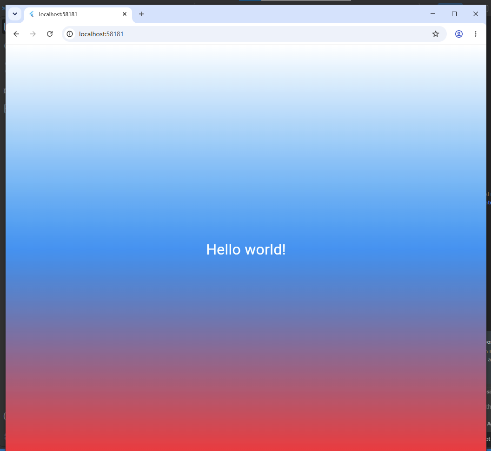

# Лабораторная работа №3. Знакомство с Flutter

первое веб-приложение на flutter, созданное с нуля для изучения структуры проекта, базовых виджетов и настройки внешнего вида экрана.

## Автор
Резник Анжелика Ильинична, группа ИСП-242

## Стек и версии
* Flutter 3.41.x (stable)
* Dart 3.13.x
* Платформа: Web (Chrome)
* IDE: VS Code

## Скриншот приложения

## Запуск
1. Клонировать репозиторий: `git clone https://github.com/Anzhela2014/lab3mob`
2. Перейти в папку проекта: `cd lab3mob`
3. Выполнить `flutter pub get`
4. Запустить командой `flutter run -d chrome`

## Что изучили
* как устроена структура flutter-проекта и за что отвечают основные папки (`lib`, `web`, `pubspec.yaml`)
* как пользоваться горячей перезагрузкой (`Hot Reload` на клавишу `r` и `Hot Restart` на `R`) и проверять дерево виджетов через `Flutter Inspector` в `DevTools`
* как строить интерфейс с нуля из дерева виджетов (`MaterialApp`, `Scaffold`, `Container`, `Center`, `Text`)